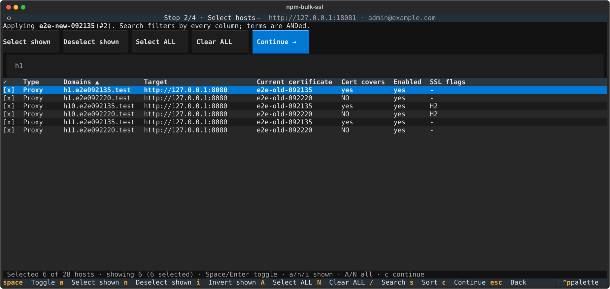
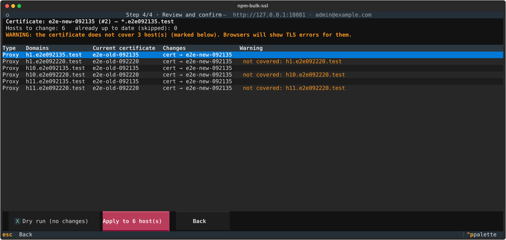

# npm-bulk-ssl

Bulk-change the SSL certificate of many [Nginx Proxy Manager](https://nginxproxymanager.com/) hosts at once, instead of
editing them one by one in the web UI.

- **Interactive terminal UI** ([Textual](https://textual.textualize.io/)): pick one certificate, then search, sort and
  multi-select hosts. You can select all, select or deselect everything currently shown (filtered), or invert the shown rows.
- Covers **proxy hosts, redirection hosts and 404 hosts**.
- **Only the certificate changes by default.** Each host keeps its own Force SSL / HTTP/2 / HSTS settings unless you choose
  to override them for the whole batch.
- **Safety:** a review screen that flags hostnames the certificate doesn't cover, a dry-run mode, a backup file written
  before every run, a one-command rollback, and an append-only audit log.
- **Headless mode** for scripts and CI (`apply`, `rollback`, `list-certs`, `list-hosts`).
- Supports NPM accounts with **2FA** and HTTPS admin endpoints (custom CA bundle or `--insecure`).
- Tested against a real NPM **2.16** container.



## Install

Requires Python 3.10+. Install it as an isolated tool with [uv](https://docs.astral.sh/uv/) (recommended) or pipx:

```bash
uv tool install git+https://github.com/dr-rei/npm-bulk-ssl
```

```bash
pipx install git+https://github.com/dr-rei/npm-bulk-ssl
```

To pin a release: `uv tool install git+https://github.com/dr-rei/npm-bulk-ssl@v1.0.0`. To upgrade:
`uv tool upgrade npm-bulk-ssl`. To try it without installing: `uvx --from git+https://github.com/dr-rei/npm-bulk-ssl npm-bulk-ssl`.

## Interactive use

```bash
npm-bulk-ssl
```

1. **Login.** You're asked for the NPM address (`10.0.0.5` → `http://10.0.0.5:81`, or a full URL such as
   `https://npm.example.com`), your email and password (hidden), and a 2FA code if the account has one.
2. **Certificate.** Choose exactly one certificate. The list shows its domains, expiry and how many hosts use it now.
3. **Hosts.** A sortable, searchable, multi-select table. The *Cert covers* column says whether the chosen certificate is
   valid for that host. Type `NO` in the search box to find the hosts it doesn't cover.
4. **SSL options.** Leave each option on *Keep current*, or force it On or Off for every selected host.
5. **Review.** See every change and any warnings, optionally tick *Dry run*, then apply. Progress is shown per host, and a
   failing host doesn't stop the run. Press `x` to cancel after the current host.



### Keys in the host table

| Key | Action |
| --- | --- |
| `/` | Focus search (every column is searched, space-separated terms are ANDed). `Enter`/`Esc` return to the table |
| `Space` / `Enter` / click | Toggle the row under the cursor |
| `a` / `n` / `i` | Select / deselect / invert the rows **currently shown** (respects the search) |
| `A` / `N` | Select / clear **all** hosts, ignoring the search |
| click header, `s`, `r` | Sort by a column (click again to reverse), cycle the sort column, reverse the sort |
| `c` | Continue |
| `Esc` | Back |

## Headless use

Connection settings come from flags or environment variables. The password can only come from `NPM_PASSWORD` or the
prompt, never from a flag, so it doesn't end up in shell history or the process list.

| Variable | Meaning |
| --- | --- |
| `NPM_URL` | NPM admin URL (`--url`) |
| `NPM_EMAIL` | Login email (`--email`) |
| `NPM_PASSWORD` | Password |
| `NPM_TOTP` | Current 2FA code (only if the account uses 2FA) |
| `NPM_BULK_SSL_HOME` | Where backups and the audit log go (`--state-dir`, default `~/.npm-bulk-ssl`) |

```bash
npm-bulk-ssl list-certs
npm-bulk-ssl list-hosts --json

# Preview: every host on *.example.com that currently uses certificate 3 -> certificate 7
npm-bulk-ssl apply --cert-id 7 --match '*.example.com' --current-cert 3 --dry-run

# Do it, and force HTTPS on them too
npm-bulk-ssl apply --cert-id 7 --match '*.example.com' --current-cert 3 --force-ssl on --yes
```

Selectors are combined with AND: `--match` / `--exclude` (globs on any domain name, repeatable), `--current-cert ID`
(`0` = no certificate), `--host proxy:12`, `--kind proxy|redirect|dead`, or `--all`. `apply` refuses to run if the
certificate doesn't cover every selected hostname, unless you pass `--allow-mismatch`. Without `--yes` it asks for
confirmation, or refuses when there is no terminal.

Exit codes: `0` success, `1` some hosts failed or were skipped, `2` usage error, `3` NPM/login/connection error,
`130` aborted.

## Backups, rollback and audit

Every run, dry runs included, writes `~/.npm-bulk-ssl/runs/<timestamp>-<action>/backup.json` **before the first change**.
The file holds each host's previous certificate and SSL flags. `results.json` records the outcome per host.

```bash
npm-bulk-ssl rollback ~/.npm-bulk-ssl/runs/20261112T021000Z-apply/backup.json --dry-run
npm-bulk-ssl rollback ~/.npm-bulk-ssl/runs/20261112T021000Z-apply/backup.json
```

Rollback restores only what differs, reports hosts that were deleted since the backup, and writes its own backup, so a
rollback can also be undone.

`~/.npm-bulk-ssl/audit.jsonl` is an append-only JSON Lines trail: run start and end, and every host with its before and
after values, status and the actor's email. Credentials and tokens are never written to disk. The token lives in memory
only.

## How it works

The tool uses NPM's own REST API, the same one the web UI uses. It sends one partial `PUT` per host containing only the
changed fields (`certificate_id` and any overridden flags), so forwarding, locations, access lists and advanced config are
not touched. After each update it reads back the response and fails the host if NPM did not apply the change. Hosts are
updated one at a time, because NPM regenerates and reloads nginx on every change. Transient errors (connection drops
during those reloads, 502/503/504) are retried with backoff.

```
src/npm_bulk_ssl/
  models.py   Host / Certificate models, wildcard coverage check
  client.py   NPM REST client (login + 2FA, retries, partial updates)
  ops.py      selection, planning, execution with backup/audit, rollback (no UI code)
  tui.py      Textual screens: certificate -> hosts -> options -> review -> progress
  cli.py      argument parsing, prompts, headless commands, exit codes
```

## Development

```bash
uv venv && uv pip install -e ".[dev]"
ruff check . && mypy src && pytest
```

End-to-end test against a **disposable** NPM. It creates certificates and hosts, so never point it at production:

```bash
docker run -d --name npm-e2e -p 18081:81 -v npm-e2e-data:/data -v npm-e2e-le:/etc/letsencrypt \
  -e INITIAL_ADMIN_EMAIL=admin@example.com -e INITIAL_ADMIN_PASSWORD=changeme123 jc21/nginx-proxy-manager:latest
NPM_E2E_URL=http://127.0.0.1:18081 pytest tests/test_e2e_real_npm.py
```

CI runs lint, type checks and unit tests on Linux, Windows and macOS (Python 3.10 and 3.13), plus the end-to-end test
against the latest NPM image.

## License

MIT
